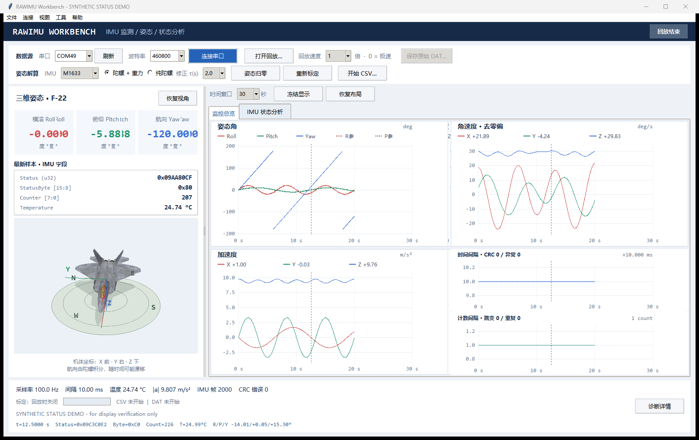
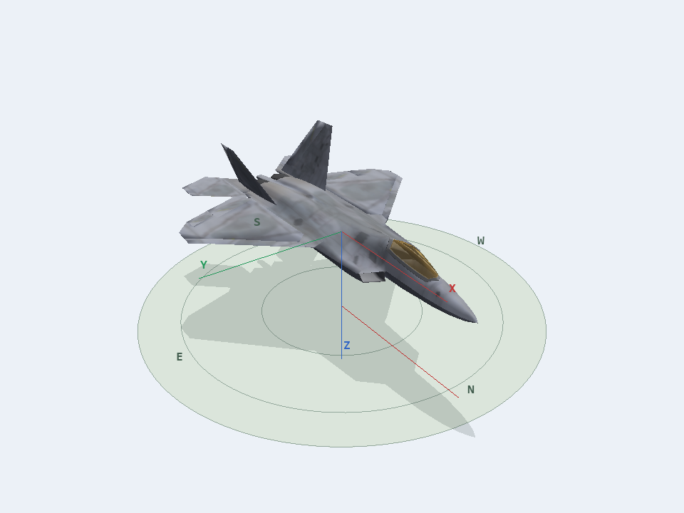
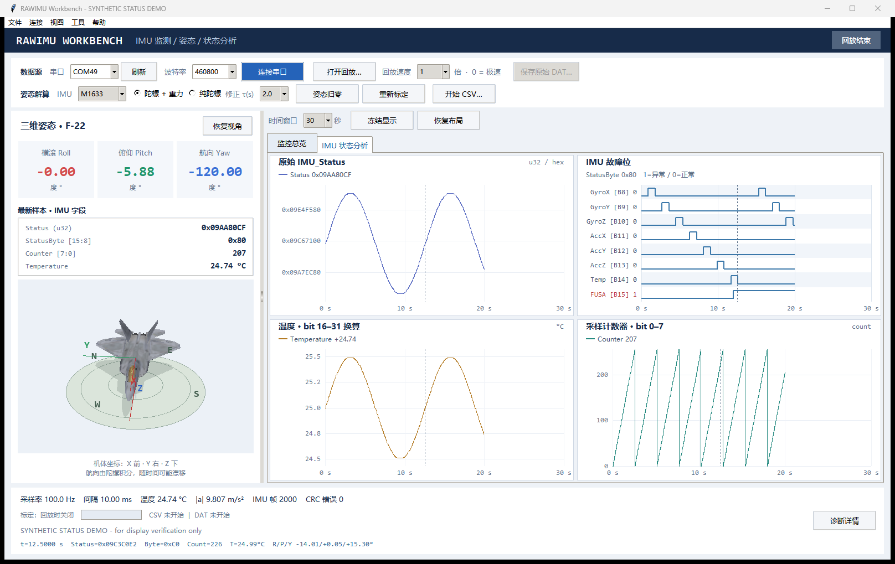
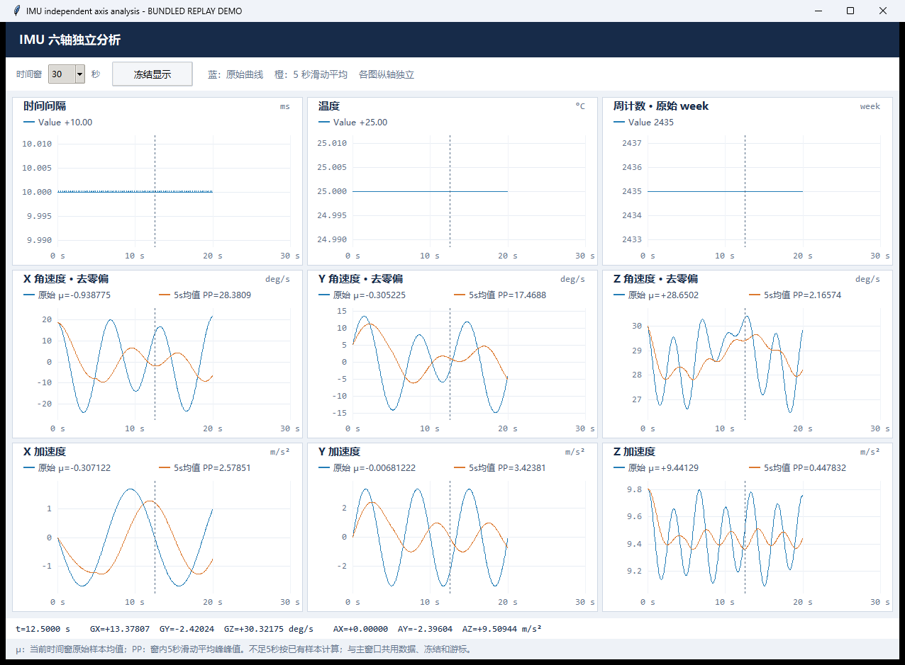
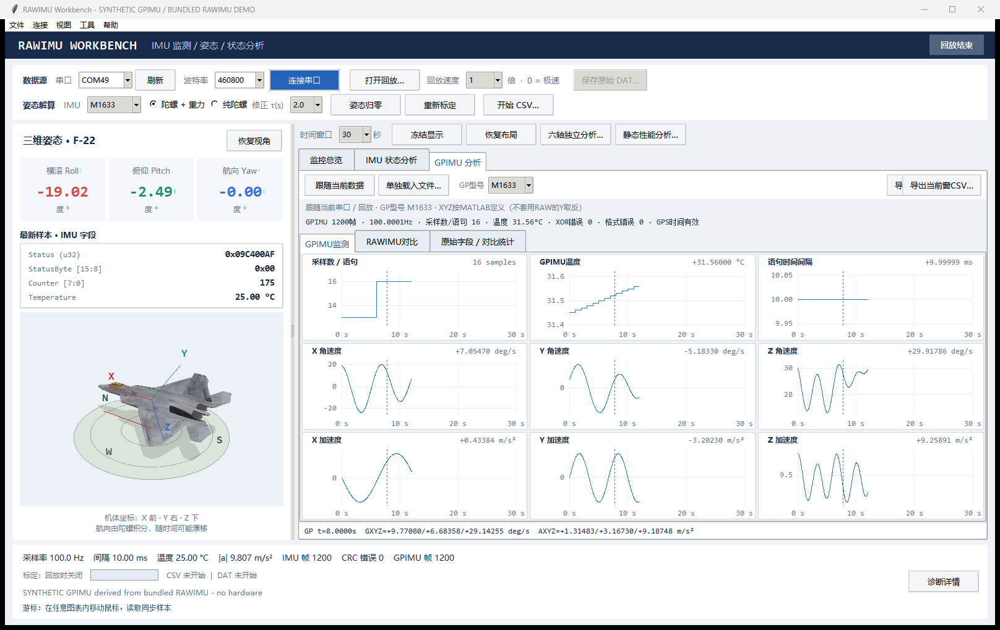
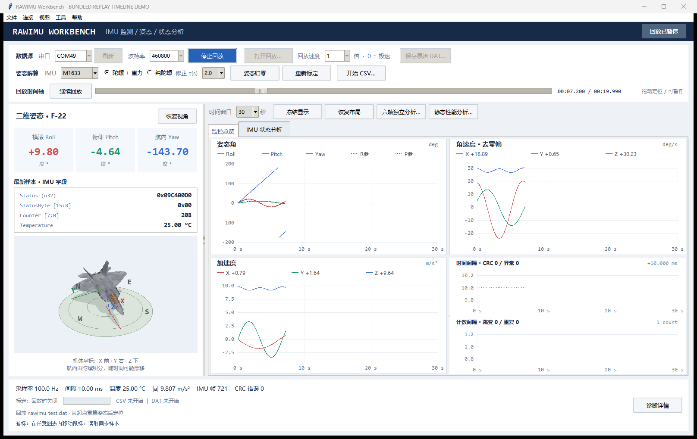
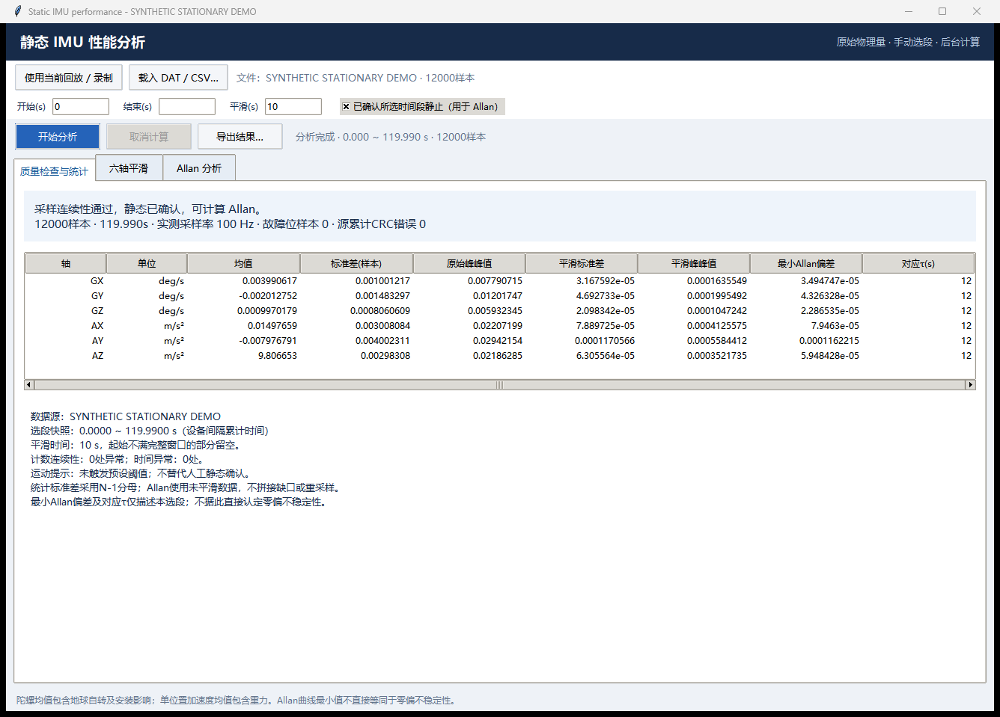
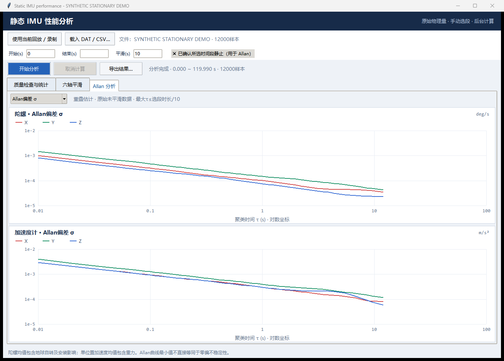
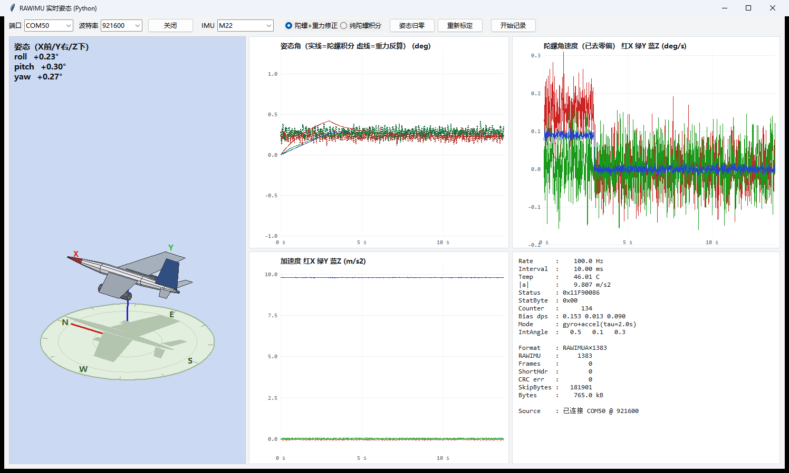

# RAWIMU Live Viewer

北云/NovAtel 风格 **RAWIMU / RAWIMUSX** 二进制报文的**串口实时解析 + 三维姿态显示**工具。

Python / Tkinter 界面，OpenGL 渲染带纹理的 F-22 三维模型，不依赖 matplotlib，可打包成 exe；另附 MATLAB 实现。



本轮优化保留 Python 3.7 / Tkinter 和现有报文、JSON 配置、CSV 列格式。界面采用工程监测工作台布局：菜单与工具栏、可拖动分区、监控总览及 IMU 状态分析页，支持同步时间窗、游标读数和冻结显示。图片中的状态变化为合成演示，不表示设备实测故障。

## 特性

- **串口实时**：波特率可配（默认 460800），断线/占用有明确提示
- **报文解析**：自动找 `AA 44 12/13` 同步头、长度字段、CRC32 校验（设备用的是“初值 0、末尾不取反”的非标准 CRC）
- **四种 IMU 报文**：二进制 `RAWIMU (0x010C)`、`RAWIMUSX (0x05B6)`；ASCII `#RAWIMUA`、`#RAWIMUSB`；新增格式只需改 JSON
- **姿态解算**：陀螺四元数积分（主体）+ 可选重力慢修正（互补滤波，只修 roll/pitch，**永不修 yaw**）
- **自动标定**：开机静止段自动估陀螺零偏、并把静止 |a| 归一到 9.80665
- **快速对准**：开局静止 0.3 s 直接用重力定 roll/pitch（原来要 5~6 s 才收敛）；运动中也用自适应增益，误差大时临时加快
- **三维显示**：FlightGear F-22 精细模型及原始机身纹理，包含座舱、进气口、双垂尾和喷口；OpenGL 深度测试、平滑光照、半透明金色座舱、罗盘与投影，随实时姿态转动。模型已随项目提供；OpenGL 不可用时自动使用 Canvas 兼容模型，错误原因可在诊断详情查看
- **状态监测**：IMU_Status 原始 32 位状态、温度和采样计数器绘图；状态字节 bit 8–15 在右上角直接显示八路命名故障电平
- **曲线**：姿态角（实线=积分，虚线=重力反算）、陀螺、加速度；坐标轴随数据自适应、刻度 1-2-2.5-5 取整
- **记录/回放**：串口原始字节流直接保存 `.dat`，可与 CSV 逐帧记录（含原始计数）同时进行；离线回放 `.dat` 走同一套解析链路
- **稳定性**：可中断的回放计时；停止、退出与记录文件写入同步；记录错误会单独提示并停止记录，采样继续
- **显示效率**：曲线按显示宽度分桶，保留峰值与断线；复用图形对象，没有新数据或布局变化时跳过曲线重绘
- **大文件自检**：分块读取日志、流式比较真值，不再将整个文件读入内存
- **可扩展**：IMU 型号表 `imu_models.json`、报文格式表 `formats.json`，改配置不用改代码

## 快速开始

### 1. 源码运行

```bash
pip install -r requirements.txt          # 串口、numpy、Pillow、PyOpenGL 与 pyopengltk
python src/rawimu_live.py                # 启动后在界面里选端口/波特率 → 打开
```

常用参数：

```bash
python src/rawimu_live.py --port COM49 --baud 460800     # 直接连
python src/rawimu_live.py --replay examples/rawimu_test.dat --speed 1   # 回放，不用硬件
python src/rawimu_live.py --replay examples/rawimu_test.dat --speed 0   # 极速回放，不等待
python src/rawimu_live.py --list-models                  # 列出 IMU 型号
python src/rawimu_live.py --list-formats                 # 列出报文格式
python src/rawimu_live.py --renderer canvas              # 手动使用简化兼容模型
python src/rawimu_live.py --selftest --replay examples/rawimu_test.dat \
       --truth examples/rawimu_truth.csv                 # 无界面自检
```

### 2. 打包成 exe

```bat
build_exe.bat
```

（用 PyInstaller，产物在 `dist\`。**建议用文件夹版**：单文件版每次启动要解压到 `%TEMP%`，
部分单位的安全软件会拦，报 `cannot create temporary directory`。）

打包脚本包含 `assets/` 模型、纹理、源文件和许可，并支持项目私有 `.vendor/` 依赖目录。源码运行时从项目目录加载资源，exe 从 PyInstaller 资源目录加载。通过“帮助 → F-22 模型来源与许可”查看作者和许可信息。截图会单独读取 OpenGL 画面，再合成到窗口截图。

模型来自 [FGMEMBERS/F-22](https://github.com/FGMEMBERS/F-22)，固定提交记录见 [assets/f22/source.json](assets/f22/source.json)。这是飞行模拟器外观模型，详细来源、运行时处理及 GPL-2.0 许可说明见 [assets/f22/README.md](assets/f22/README.md)。



### 3. 界面操作

| 操作 | 说明 |
|---|---|
| 端口/波特率 + 连接串口 | 连接实时数据（自动枚举串口） |
| 刷新 | 重新枚举串口，保留手动输入的端口 |
| 打开回放… | 选择 `.dat / .bin / .log` 文件；开始新数据源时重置历史与统计 |
| 回放速度 | 启动前选择 0.25 / 0.5 / 1 / 2 / 4 倍；0 为不节流的极速回放 |
| 回放时间轴 | 显示当前位置/总时长；拖动滑块或用方向键定位，支持暂停/继续及结束后从头播放 |
| 断开连接 / 停止回放 | 请求后台停止；线程退出前禁止启动其它数据源 |
| IMU 下拉框 | 切换 IMU 型号（重新标定） |
| 陀螺+重力修正 / 纯陀螺积分 | 姿态算法模式 |
| 姿态归零（空格） | 姿态重置 |
| 重新标定 | 重估零偏 + 加计标度（设备需静止） |
| 开始 CSV… | 选择 CSV 保存路径，默认 `rawimu_YYYYmmdd_HHMMSS.csv`（含原始计数） |
| 保存原始 DAT… | 连接串口后选择 `.dat` 路径，保存从开始记录之后收到的全部原始字节 |
| 停止 DAT | 关闭并刷新原始数据文件；CSV 记录可继续 |
| 显示窗口 | 切换最近 10 / 30 / 60 秒的曲线 |
| 监控总览 | 同时查看姿态角、角速度、加速度；右下角直接绘制采样时间间隔和 IMU 计数间隔 |
| IMU 状态分析 | 四格直接显示：左上原始状态字、右上八路 IMU 故障位、左下温度、右下采样计数器，无需子页切换 |
| GPIMU 分析 | 独立解析GPIMU，查看六轴、语句内采样数、温度、时间间隔及与RAWIMU的GPS同历元对比；可单独载入文件 |
| 六轴独立分析… | 从工具栏或“视图”菜单打开独立九宫格窗口：时间间隔 / 温度 / week，X/Y/Z角速度，X/Y/Z加速度 |
| 静态性能分析… | 手动选择当前会话或录制文件的静态段，检查连续性、统计六轴噪声、绘制10秒平滑及Allan曲线、导出结果 |
| 拖动左右分隔条 | 调整三维姿态/当前状态与图表区的宽度 |
| 冻结显示 / F6 | 固定当前曲线与字段；后台采样、统计和 CSV 记录继续，恢复后显示最新数据 |
| 图表内移动鼠标 | 同步游标定位最近的真实样本，底部显示时间、状态字、状态字节、计数、温度和姿态角 |
| 恢复布局 | 恢复默认分区宽度 |
| 恢复视角 | 恢复三维场景默认相机位置 |
| 诊断详情 | 查看报文统计、状态字、采样计数、零偏、累计转角与标定日志 |
| ESC | 退出 |

左侧红/绿/蓝读数分别表示横滚 Roll、俯仰 Pitch、航向 Yaw；曲线中同色实线为解算输出，虚线为重力参考。角度经过 ±180° 时断开跨界连线。无数据时用“—”占位，并显示姿态示意。

顶部显示未连接、正在连接、实时接收、等待 IMU 数据、回放、结束或错误。底部持续显示采样率、温度、CRC 错误、标定进度和记录状态，错误不会被普通刷新覆盖。界面支持最小 1100×720，默认 1600×960；窄窗口中姿态读数和位号会自动缩小字号。

### 数据完整性监控

“监控总览”右下角直接显示两张共用时间窗的曲线：上方为相邻有效 IMU 样本的原始时间间隔（ms），下方为相邻 IMU 计数的差值（count）。第一帧没有前一帧可比较，留空。虚线表示当前配置的期望时间间隔与期望计数差值 1；曲线保留峰值和实际异常差值，不用姿态积分的回退间隔替换它们。

曲线标题同时显示 CRC 错误、计数跳变、重复计数及间隔异常的累计统计，切换数据源后重置。CRC 错误包含二进制及已识别 ASCII 报文的校验失败，即使尚未收到有效 IMU 帧也会更新。

计数间隔曲线将正常的 255→0（原始差值 −255）显示为 +1，其余差值原样保留，包括重复 0、正向跳变和负向回退。累计统计仍按模 256 比较，步长 0 计入重复，其余非 1 步长计入跳变。跳变可能由丢帧、乱序或重启等引起，不直接当作确认丢帧数。间隔异常容差为期望间隔的 15%，且不小于 0.5 ms。

完整性监控与 IMU 故障位分别表示接收数据质量和设备报告的状态。冻结显示时，完整性面板也随当前快照冻结；底部采样和记录仍继续更新。

### IMU 状态显示



| 字段 | 显示方式 | 解释 |
|---|---|---|
| IMU_Status | 8 位十六进制数值与阶梯曲线 | 完整原始 u32 字段，温度和计数的变化也会使其变化 |
| bit 8–15 / StatusByte | 右上角 8 条命名故障位，左侧保留十六进制数值 | 按本项目 `rawimu_status.m` 定义，0 正常、1 异常；同时保留 B8–B15 原始位号 |
| bit 16–31 / Temperature | °C 数值与温度曲线 | 有符号温度原始值按型号系数换算 |
| bit 0–7 / Counter | 0–255 阶梯曲线 | 采样计数，255→0 为正常回绕 |

全部图表使用同一时间窗；数字波形在窗口左侧保留已知的前一电平，不在离散状态之间画插值斜线。左侧“最新样本”显示最新数据，冻结时改为“冻结样本”；游标对应的历史样本另列于底部。状态历史与姿态、加速度等数据逐帧对齐，CSV 原有列格式不变。

故障位名称已与上层工程的 `rawimu_status.m` 和 `raw/desay_imu_status_details.m` 同步，图中从上到下依次为：

| StatusByte 位 | 原始状态字位 | 名称 |
|---:|---:|---|
| 0 | B8 | GyroX |
| 1 | B9 | GyroY |
| 2 | B10 | GyroZ |
| 3 | B11 | AccX |
| 4 | B12 | AccY |
| 5 | B13 | AccZ |
| 6 | B14 | Temp |
| 7 | B15 | FUSA |

当前置位的名称在图中标红，“诊断详情”的 Faults 行列出当前异常项。名称采用本项目的设备约定；Temp 指温度故障位，与温度数值曲线区分。故障位名称不影响各 IMU 型号的温度换算系数。

可复现界面截图（使用合成状态位变化，不打开串口）：

```bash
python tests/preview_status_monitor.py
python tests/preview_status_monitor.py --compact --output-dir YOUR_OUTPUT_DIR
```

### 六轴独立分析窗口



点击“六轴独立分析…”即可打开或唤回同一个独立窗口，支持调整大小。按三行三列排列：首行时间间隔（ms）、温度（°C）、原始周计数（报文week字段，区别于8位IMU采样计数器）；第二行X/Y/Z去零偏角速度（deg/s）；第三行X/Y/Z加速度（m/s²）。六轴各有独立纵轴，支持查看微小噪声。

蓝线为主窗口相同物理量的原始曲线，橙线为尾随5秒内样本的算术平均；时间窗开始前的数据也参与平均，启动不足5秒时按已有样本计算，缺失值或时间回退会重新开始平均。图例μ为当前时间窗内原始样本均值，PP为窗内滑动平均曲线的峰峰值，均使用对应图表的单位。

独立窗口与主窗口共用10/30/60秒时间窗、冻结/恢复显示及游标。移动鼠标可在窗口底部读取同一时刻的六轴值。关闭该窗口不会停止采集、DAT或CSV记录；重开时恢复当前显示数据，主程序退出时一起关闭。

```bash
python tests/preview_axis_analysis.py
python tests/preview_axis_analysis.py --compact --output-dir YOUR_OUTPUT_DIR
```

### GPIMU 分析视图

主界面新增“GPIMU 分析”页，也可从“视图 → GPIMU 分析”进入。参照上层 `M22p_gpimu.m`、`read_gpimu.m`、`load_gpimu2imudata.m` 和 `load_imu_model.m`，提供：

- **GPIMU监测**：九宫格首行显示每条语句聚合采样数、温度及语句时间间隔；第二行三轴角速度（deg/s），第三行三轴加速度（m/s²）。采样数不是递增帧序号，不套用RAWIMU模256连续性规则。
- **RAWIMU对比**：六轴物理量叠加显示；按有效GPS周/周内秒寻找容差内最近的一对一历元，默认2ms，可修改。可见选段重复GP历元、重复RAW历元、等距候选或无匹配的数据留空，不插值或自动拟合标度。对比统计显示GP−RAW均值、样本标准差和峰峰值。RAW值来自自动零偏/加速度归一化之前的原始计数及该次配置的固定标度。
- **原始字段 / 对比统计**：GPIMU时间、GPS周/周内秒、采样数、语句间隔、类型/标志和六轴原始十六进制计数等。类型/标志不是RAWIMU的IMU_Status，不解读为其故障位。



默认跟随当前串口/回放，共用主窗口的10/30/60秒时间窗及冻结显示；GPIMU与RAWIMU分别缓存和计数，不会重复积分驱动姿态。纯GPIMU文件支持原回放时间轴、暂停及定位，并自动切换到GPIMU页；混合文件保留RAWIMU主时间轴，GPIMU随已读取的文件前缀更新。GPIMU无有效GPS周时，使用其IMU时间显示语句间隔，明确提示无法与RAW按GPS配对。

点击“单独载入文件…”可在后台读取 `.dat / .bin / .log / .txt`，保留完整GP历史和RAW对比数据，不改变实时串口或主回放。文件位置滑块选择查看时段，主窗口的时间窗长度用于截取可见范围；切换主数据源不清空独立文件。点击“跟随当前数据”返回当前流。“导出当前窗CSV…”只导出可见GP窗口，包括型号、时间、采样数、温度、六轴物理量、匹配RAW值及时间偏差。

GP型号独立于RAW型号，支持M1633、M21和M22；GP使用MATLAB定义的XYZ轴，不重复套用RAW的Y取反或自动标定。M1633/M21陀螺比例为1/(100·65536)deg/s/LSB；M22的Z轴为−1/(16896·256)。M1633加速度比例为1/(200·65536)，M21/M22为9.80665/(2000·65536)m/s²/LSB。温度M1633为raw/100，M21为raw/256+25，M22按MATLAB组合型号规则将低16位解释为有符号数后除128。

当前支持带GPS周、周内秒和温度的GPIMU32格式（18/19个逗号字段），六轴和温度为8位十六进制，独立校验2位XOR；不通过校验或字段不足分别计数并拒绝入图。旧布局/16位格式不猜测换算。协议与源码依据见 [docs/protocol.md](docs/protocol.md)。

```bash
python tests/preview_gpimu.py
python tests/preview_gpimu.py --compact --output-dir YOUR_OUTPUT_DIR
python src/rawimu_live.py --replay examples/gpimu_test.dat --speed 1
```

`examples/gpimu_test.dat` 是将项目内置RAWIMU轨迹换算为同历元GPIMU、重新生成XOR后混合的合成夹具（1200+1200帧），不代表设备实测。原 `M22p_gpimu.m` 中引用的旧桌面数据路径当前不存在，本功能未修改该MATLAB脚本。

### 回放时间轴



打开回放后，工具栏下方显示时间轴、当前位置/总时长和暂停/继续按钮。时间按报文中的设备时间累计，不受回放倍速影响。首次打开文件时后台扫描建立时间索引，显示扫描进度，可随时停止；索引使用约16字节/有效IMU样本，复用时检查文件路径、大小和修改时间。串口模式自动隐藏时间轴。

拖动滑块时预览目标时间，释放后跳转；滑块获得焦点后也可用方向键定位。跳转会先停止旧回放，在后台从文件起点快速重算到目标有效样本，保证姿态、状态、曲线和静态分析历史来自同一前缀。保持原先的暂停/播放状态，回放结束后拖动定位会暂停在目标位置，点击“从头播放”则重新开始。长文件靠后的位置可能需要等待重算；重算期间界面可操作和停止。

“暂停回放”停止推进数据；“冻结显示”只固定显示，后台回放和记录仍可继续。暂停后恢复会重置计时基准，不会追赶暂停期间的墙钟时间。回放按有效IMU帧边界读取原始字节，并在处理下一帧前按设备时间等待；损坏/未知报文仍由原解析链路计数。设备时间回退、非有限值或超过10秒的超大跳变在导航时间轴上按一个名义周期推进，原始时间异常仍保留在完整性及性能检查中。回放中文件发生变化会报错，需重新打开文件。

CSV录制期间可暂停/继续，但禁止跳转，避免重复或倒退样本写入CSV；建立索引或定位重算期间也禁止启动CSV，完成后再选择录制。回放时关闭自动零偏和加计标度标定；切回串口后恢复启动配置。每次切换数据源都会结束当前记录，需重新选择记录文件。

```bash
python tests/preview_replay_timeline.py
python tests/preview_replay_timeline.py --compact --output-dir YOUR_OUTPUT_DIR
```

### 静态 IMU 性能分析

从工具栏或“视图 → 静态性能分析…”打开独立窗口。支持当前实时采集/回放的完整历史，也可单独载入 `.dat / .bin / .log / .csv` 文件；文件分析不会替换串口或回放数据源。选择正确IMU型号后载入文件，输入开始/结束时间（结束留空表示当前快照末尾），确认所选段静止，再点击“开始分析”。数据仍可继续接收和录制，计算结果固定在开始分析时读取的快照。



窗口包含三页：

- **质量检查与统计**：样本数、时长、实测采样率、时间异常、计数连续性、故障位及源累计CRC错误；六轴均值、样本标准差、原始峰峰值、平滑标准差/峰峰值及最小Allan偏差/对应τ。运动提示使用角速度标准差0.05deg/s、均值模长3deg/s，加速度标准差0.05m/s²及重力模长偏离0.5m/s²等阈值，仅提示人工复核，不自动认证静止。
- **六轴平滑**：原始曲线与默认10秒尾随样本均值，平滑秒数可调整；按实测设备间隔累计时间，不使用回放倍速或界面刷新周期。每个连续段开头不满完整窗口的部分留空；数据缺口、计数异常及配置切换会重新开始平滑。
- **Allan分析**：三轴陀螺和三轴加速度计双对数曲线，支持Allan偏差σ与Allan方差σ²切换，使用原始未平滑数据。默认“连续采样（容许抖动）”允许有界的小时间戳抖动，按连续样本和实测平均周期作等间隔近似，明确显示抖动数量及时间口径；可改用“严格设备时间（2%）”。未确认静止、缺失值、状态字缺失、真实时间不连续、计数不连续或跨型号配置时仍不计算Allan。首个选中样本与选段外前一帧之间的间隔不计入选段质量判断。



Allan采用相邻重叠m样本均值之差的平方平均再除以2，有效项数为N−2m+1，τ=m·实测采样周期。m按对数分布选取，最大τ不超过选段时长的1/10。实现与独立逐段均值参考计算、恒定偏置不变性及白噪声测试核对。方法参考 [MathWorks惯性传感器Allan分析](https://www.mathworks.com/help/fusion/ug/inertial-sensor-noise-analysis-using-allan-variance.html) 及 [NIST频率稳定性分析手册](https://www.nist.gov/publications/handbook-frequency-stability-analysis)。曲线最小值仅描述所选数据，不直接作为零偏不稳定性指标；陀螺均值含地球自转等影响，单位置加速度均值含重力。

时间检查把大于2%的间隔偏差与真正不连续区分显示。连续模式要求逐帧计数完整，所有正向间隔相对中位周期偏差不超过10%（最小绝对容差2µs），且累计设备时间相对平均周期网格的最大偏离不超过一个周期的25%（最小2µs）。严格模式保留2%间隔门限，并同样检查累计偏离。这些是软件的工程接受门限，普通Allan仍以等间隔序列为基础；连续模式明确标为近似，不修改测值、不插值、不删掉或拼接缺口。10秒平滑按实际时间窗口计算，小抖动不再反复重置平滑窗口，真正不连续仍重置。

实测回归：`CONN3-COM51-921600_filecopy2.dat` 共1261246样本、CRC0、计数全程连续，间隔9.422～10.581ms，旧2%门限误拦18712处；平均频率99.9999989Hz，累计时标最大偏离0.488842ms。修正后整段等间隔近似Allan计算通过，原测值不变。诊断和原文件实际结果见 [质量报告](docs/diagnostics/allan_actual_timing_report.json)、[六轴摘要](docs/diagnostics/allan_actual_summary.csv) 及 [Allan曲线](docs/diagnostics/actual_timestamp_jitter_allan.png)。

当前会话使用独立临时二进制缓存，保存轴映射后的原始计数与该次配置起始的固定标度换算结果，不混入姿态解算的自动去零偏/加速度归一化。显式型号配置变更会标记边界。缓存不受65秒显示历史限制，切换数据源/退出程序时释放；要长期保留数据仍需使用DAT或CSV录制。无效时间或超过10秒的超大设备时钟跳变按一个名义周期推进分析选择轴，原始间隔保留并触发质量检查。缓存错误会单独显示，采集继续。

CSV优先读取 `gx_raw/gy_raw/gz_raw/ax_raw/ay_raw/az_raw`，按所选型号标度换算；原始计数已经过轴映射，不再重复取反。仅有 `wx/wy/wz/ax/ay/az` 时使用这些物理量并提示可能已补偿。CSV需有 `t_s`，Allan完整性检查还需要有效 `status` 或 `counter`。

“导出结果…”生成同前缀的4个文件：`_summary.csv`（统计及单位）、`_allan.csv`（τ、有效项数、聚类数、六轴方差及偏差）、`_timeseries.csv`（完整选段原始量与平滑量）和 `_report.json`（来源、配置、质量检查及平滑参数）。计算、加载和导出均可取消，关闭窗口不会停止采集或录制。

```bash
python tests/preview_performance.py
python tests/preview_performance.py --compact --output-dir YOUR_OUTPUT_DIR
```

### 保存原始 DAT

1. 连接串口。
2. 点击顶部“保存原始 DAT…”（或“文件 → DAT 开始 / 停止原始记录…”），选择文件路径。
3. 底部显示记录文件名和已写入字节数；点击“停止 DAT”结束保存。断开串口、切换数据源或退出程序也会关闭并刷新 DAT 文件。
4. 使用“打开回放…”选择这个 `.dat` 文件，即可再次解析和显示；也可运行 `python src/rawimu_live.py --replay YOUR_FILE.dat --speed 1`。

DAT 是接收字节的原样保存，不添加文件头，不重新编码报文，包含未知报文、ASCII/NMEA、噪声以及 CRC 错误帧；错误帧仍按解析规则过滤显示。它保存的是开始记录之后收到的数据，不包含之前的历史和串口发送命令。DAT 与 CSV 可同时记录并分别停止，冻结显示不会停止记录。DAT 写入失败会停止该文件的记录并提示，串口解析与 CSV 记录继续。原始 DAT 录制仅用于已连接的串口，回放期间该按钮不可用。

## 报文协议

帧格式、字段偏移与量纲换算见 [docs/protocol.md](docs/protocol.md)。要点：

**二进制（RAWIMU / RAWIMUSX）**

- 帧：`AA 44 12`(长头 28B) / `AA 44 13`(短头 12B) + 体 + 4B CRC
- 体（40B）：`week | seconds_into_week(f64) | imu_status(u32) | Z/Y/X 加速度(i32×3) | Z/Y/X 角速度(i32×3)`
- 定点：陀螺 **1 LSB = 1/65536 deg/s**，加计 **1 LSB = 0.5/65536 m/s²**（32 位定点、16 位小数）
- `IMU_Status`：高 16 位温度，低 8 位采样计数，8–15 位状态字节

**ASCII（#RAWIMUA / #RAWIMUSB）**

```
#RAWIMUA,COM3,0,98.3,FINESTEERING,1356,82.500,00000000,0399,816;2446,93852.015821,11dd0080,1303471,-6343,-6566,6013,-3722,4165*0f02cca6
└──────────── 日志头（逗号分隔）────────────┘ └──────────── 数据体 ────────────┘ └ CRC ┘
```
- 分号后：`week, seconds, imu_status(hex), acc_z, acc_y, acc_x, gyr_z, gyr_y, gyr_x`
- 末尾 `*crc32` 覆盖的是**去掉前导 `#` 之后**的内容（已按此校验）
- 定点与二进制完全相同，所以同一个 `imu_models.json` 通用

## 扩展 IMU 型号 / 报文格式

复制 `examples/imu_models.example.json` → 程序目录下 `imu_models.json`，加一组即可：

```json
{
  "MY_IMU": {
    "gyro_lsb": 1.52587890625e-05,
    "accel_lsb": 7.62939453125e-06,
    "temp_lsb": 0.01, "temp_offset": 0.0, "freq": 100,
    "invert_y": true, "axis_map": [0,1,2], "axis_sign": [1,1,1]
  }
}
```

新增**二进制**报文格式（`formats.json`），字段表驱动：

```json
{
  "RAWIMUA_BIN": {
    "id": 269, "header_len": 28, "body_len": 40, "enabled": false,
    "week":  {"off": 0,  "type": "u16"},
    "sow":   {"off": 2,  "type": "u32"},
    "status":{"off": 6,  "type": "u32"},
    "acc":   {"off": 10, "order": ["z","y","x"]},
    "gyr":   {"off": 22, "order": ["z","y","x"]}
  }
}
```

新增 **ASCII** 格式：

```json
{
  "MY_ASCII": {
    "kind": "ascii", "prefix": "#RAWIMUA",
    "week": {"idx": 0}, "sow": {"idx": 1}, "status": {"idx": 2},
    "acc": {"idx": [3,4,5], "order": ["z","y","x"]},
    "gyr": {"idx": [6,7,8], "order": ["z","y","x"]}
  }
}
```

- 二进制类型：`u8/i8/u16/i16/u32/i32/f32/f64/i32x3`；ASCII 用分号后的下标 `idx`
- `order`：报文里的物理顺序
- 未识别报文：`--selftest --dump-unknown` 会打印 ID/头长/体长/前 56 字节 hex，ASCII 会列出未识别前缀，照着填即可

内置型号：`M1633 / M22 / M21`（M22 为 COM50 实机标定值，M21 同系列暂沿用）。
内置格式：`RAWIMU`、`RAWIMUSX`（二进制）、`RAWIMUA`、`RAWIMUSB`（ASCII）。

## 验证

```bash
python src/rawimu_live.py --selftest --replay examples/rawimu_test.dat --truth examples/rawimu_truth.csv
```

```
帧 2000  IMU 2000  其它 0  短头 0  CRC错 0  丢弃字节 0
报文格式统计: RAWIMU×2000
时长 20.0 s  平均帧间隔 10.000 ms  温度 25.00 C  平均|a| 9.807 m/s2
末姿态 roll -0.00 pitch -5.88 yaw -120.00
对比真值 meanerr roll=0.00000 pitch=0.00000 yaw=0.00000 deg
```

`examples/rawimu_test.dat` 是 20 s 已知姿态（roll±20°、pitch±10°、yaw 30°/s）的合成数据，
`rawimu_truth.csv` 是对应真值，用于回归。

真值 CSV 第一行数据表示第一次积分之前的初始姿态，后续行依次对应积分结果。自检检查时间递增及帧间对齐（容差 0.5 ms）；当前样例末帧没有对应真值，会明确报告比较其余 1999 帧。空日志、真值不足、时间错位等返回非零退出码。

新增回归测试及可复现的本地性能对比：

```bash
python -m unittest discover -s tests -v
python tests/benchmark_viewer.py --baseline c7dce6e
python tests/benchmark_viewer.py --baseline c7dce6e --plots  # 会打开 Tk 绘图窗口
```

Windows / Python 3.7 本机测得中位耗时如下，仅作同机比较；CRC 为独立微基准，不代表整个程序的加速比例。

| 场景 | 原版 | 优化版 |
|---|---:|---:|
| CRC，68 字节 × 20000 次 | 166.44 ms | 4.62 ms |
| 二进制样例解析，2000 帧 | 67.61 ms | 55.17 ms |
| ASCII 样例解析，797 个 IMU 帧 | 61.69 ms | 50.35 ms |
| 三通道曲线，6000 点，含 Tk 绘制 | 11.31 ms | 10.61 ms |
| 三通道曲线，60000 点，含 Tk 绘制 | 126.74 ms | 69.85 ms |

大数据量绘图耗时接近减半。上述绘图基准针对单张三通道图，不等于整个界面刷新耗时；隐藏页会暂停绘制。减点仅用于显示，姿态解算和 CSV 记录保留全部数据。

已验证二进制、ASCII 样例、真实 Tk 窗口及模拟串口生命周期；本轮没有连接硬件进行串口实测。

ASCII 报文用实采数据回归（8 s，`#RAWIMUA`，来自 COM50 @921600）：

```bash
python src/rawimu_live.py --selftest --replay examples/rawimua_ascii.dat
# 二进制帧 0（CRC错 0）  ASCII 行 1778  IMU 帧 797
# 报文格式统计: RAWIMUA×797   ASCII 行 1778（CRC错 0）
# 时长 8.0 s  平均帧间隔 10.000 ms  温度 45.75 C  平均|a| 9.950 m/s2
```



## 目录结构

```
rawimu-live/
├─ src/rawimu_live.py          主程序
├─ src/aircraft_mesh.py        AC3D 模型读取与网格准备
├─ src/aircraft_gl.py          OpenGL 三维视图
├─ src/axis_analysis.py        九宫格独立分析与时间滑动平均
├─ src/performance_data.py     全会话分析缓存与录制文件载入
├─ src/imu_performance.py      静态统计、平滑与重叠Allan计算
├─ src/performance_window.py   静态性能分析独立窗口
├─ src/replay_timeline.py      回放时间索引与时间轴控制
├─ src/gpimu_data.py           GPIMU32校验、型号换算和历元配对
├─ src/gpimu_view.py           GPIMU监测及独立文件分析视图
├─ assets/f22/                 F-22 源模型、纹理、作者与许可
├─ tests/                      回归测试与可选性能基准
├─ examples/                   回归数据（二进制 + ASCII）与配置模板
├─ docs/protocol.md            帧格式与量纲
├─ docs/images/                界面截图
├─ matlab/                     MATLAB 等价实现
├─ build_exe.bat               PyInstaller 打包
├─ requirements.txt
└─ LICENSE
```

## MATLAB 版

`matlab/` 下是与本工具功能对应的 MATLAB 实现（`rawimu_live.m` 实时解析+3D 姿态、
`rawimu_make_testfile.m` 生成测试数据、`novatel_crc32.m` 设备 CRC），
说明见 [matlab/README.md](matlab/README.md)。

## 串口与网口连接

顶部“数据源”可选择串口、TCP 客户端、TCP 服务端或 UDP 接收。每次连接使用一个数据源，RAWIMU/GPIMU 共用解析、绘图和录制流程。

| 模式 | 地址和端口 | 操作 |
| --- | --- | --- |
| 串口 | COM 号、波特率 | 连接串口 |
| TCP 客户端 | 设备的 IPv4 地址和服务端口 | 连接网口 |
| TCP 服务端 | 本机 IPv4 地址、监听端口 | 开始监听，等待设备连接；断开后继续等待 |
| UDP 接收 | 本机 IPv4 地址、接收端口 | 开始监听，由设备向此端口发数据 |

服务端和 UDP 的 `0.0.0.0` 表示监听本机所有 IPv4 网卡。UDP 锁定首个非空数据包的发送 IP/端口（独立命令目标的纯应答除外），其他发送端的包不混入当前数据流；需要更换发送端时先断开再监听。UDP 使用 1 MiB 接收缓冲，但传输中的丢包仍需通过完整性图检查。

串口和网口均支持“保存原始 DAT”，按接收顺序保存所选连接的原始字节；TCP/UDP 的 IP 包头不写入 DAT。CSV、状态分析、静态性能分析沿用现有流程。

```powershell
python src/rawimu_live.py --source tcp_client --host 192.168.1.100 --network-port 3001
python src/rawimu_live.py --source tcp_server --host 0.0.0.0 --network-port 3001
python src/rawimu_live.py --source udp --host 0.0.0.0 --network-port 3001 --time-axis sow
```

## 命令发送视图

打开“命令发送”标签，复用当前串口或网口连接手动发送命令。连接串口、TCP 客户端或 TCP 服务端的设备后，输入内容并点击“发送命令”或按 `Ctrl + Enter`。

- **文本 ASCII**：选择 CRLF、CR、LF 或无结束符；输入末尾已有的换行会替换为所选结束符。
- **HEX 字节**：例如 `AA 00 FF 12`，允许空白分隔，不追加结束符。
- **UDP**：可回复已锁定发送端，或指定目标 IPv4 和端口；指定目标允许在收到数据前发送。
- **应答与历史**：显示实际写入结果及设备文本应答，支持 HEX 预览、暂停接收显示、最近 30 条命令、清空/保存日志。选择历史命令仅载入输入框。

发送由独立线程复用原连接执行，读取和 DAT/CSV 录制继续；串口大命令分块写入，断开连接取消尚未发送的命令，旧命令不会发送到替换后的连接。回放不发送命令。写入成功表示数据已交给连接，设备是否接受/执行需查看应答；失败不自动重发。

UDP 指定其他目标时，其 30 秒内的返回可在命令区显示来源 IP/端口，同时保持原 IMU 发送端锁定；其他目标的应答不混入 IMU 解析和 DAT 数据流。

文本应答按 CR/LF 分行，只显示可打印 ASCII，过滤 RAWIMU/GPIMU 高频报文。HEX 预览按接收块显示，TCP/串口的接收块不代表协议帧。预览每块最多 256 字节、日志最多保留 1000 行；该过滤与截断只影响界面，不改变原始 DAT。DAT 仅保存接收字节，命令收发日志单独保存。

## 时间轴切换

“横轴”支持“相对时间 (s)”和“GPS 周内秒 (s)”，主监控、故障位、完整性图、六轴窗口、GPIMU 及静态平滑时序图同步切换。游标显示该样本的 GPS 周与周内秒。切换标签保留冻结缩放、样本索引及回放定位，内部仍使用经过时长进行等距绘制和平滑计算。

GPS 周内秒来自报文，跨周按 604800 秒回绕；时钟跳变的区间不插值成虚构 GPS 时间。缺少有效 GPS 时间时显示 `—`/“不可用”。旧 CSV 的 `t_s` 仅是相对时间，不能据此恢复 GPS 周内秒；DAT 保留原报文时间。Allan 横轴始终为聚类时间 τ，静态选段与回放定位仍按经过秒数。

## 冻结后的图表操作

点击“冻结显示”后，在各图绘图区内使用滚轮放大或缩小、按住左键拖动平移、双击恢复初始范围。
`Shift + 滚轮`只缩放时间轴，`Ctrl + 滚轮`只缩放纵轴。每张图独立操作，IMU 故障位图保持八个状态通道，只缩放时间轴。
主界面、六轴独立窗口、GPIMU 及完整性间隔图均支持；独立载入的 GPIMU 文件、静态性能平滑图和 Allan 对数图可直接操作。
恢复实时显示会清除缩放；改变时间窗口会重新显示所选范围。缩放不改变数据，采集和录制在冻结期间继续。

## 已知限制

- yaw 只来自陀螺积分，长时间会缓慢漂移（重力给不出 yaw）；要绝对航向需双天线 GNSS 或磁力计融合
- 支持注册的 NovAtel/Bynav 风格二进制和 ASCII IMU 报文；未注册 ASCII/NMEA 语句跳过（仅统计）。已识别 ASCII 报文的 CRC 错误帧不参与解算
- 单文件 exe 在禁止写 `%TEMP%` 的机器上需改用文件夹版

## License

程序代码采用 MIT，见 [LICENSE](LICENSE)。F-22 模型与纹理采用 GPL-2.0，保留原作者说明及完整许可，见 [assets/f22/README.md](assets/f22/README.md) 和 [assets/f22/COPYING](assets/f22/COPYING)。
