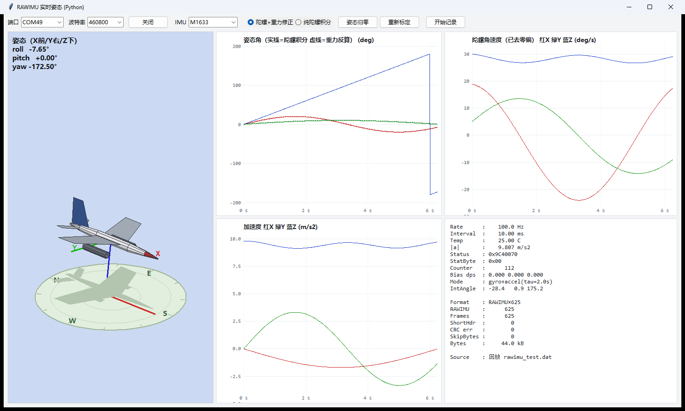

# RAWIMU Live Viewer

北云/NovAtel 风格 **RAWIMU / RAWIMUSX** 二进制报文的**串口实时解析 + 三维姿态显示**工具。

纯 Python（Tkinter 自绘 3D，不依赖 matplotlib），可打包成单文件 exe；另附一份功能等价的 MATLAB 实现。



## 特性

- **串口实时**：波特率可配（默认 460800），断线/占用有明确提示
- **报文解析**：自动找 `AA 44 12/13` 同步头、长度字段、CRC32 校验（设备用的是“初值 0、末尾不取反”的非标准 CRC）
- **四种 IMU 报文**：二进制 `RAWIMU (0x010C)`、`RAWIMUSX (0x05B6)`；ASCII `#RAWIMUA`、`#RAWIMUSB`；新增格式只需改 JSON
- **姿态解算**：陀螺四元数积分（主体）+ 可选重力慢修正（互补滤波，只修 roll/pitch，**永不修 yaw**）
- **自动标定**：开机静止段自动估陀螺零偏、并把静止 |a| 归一到 9.80665
- **三维显示**：飞机模型 + 罗盘台 + 航向指针 + 地面投影（全部自绘，随姿态实时转动）
- **曲线**：姿态角（实线=积分，虚线=重力反算）、陀螺、加速度；坐标轴随数据自适应、刻度 1-2-2.5-5 取整
- **记录/回放**：CSV 逐帧记录（含原始计数）；离线回放 `.dat` 走同一套解析链路
- **可扩展**：IMU 型号表 `imu_models.json`、报文格式表 `formats.json`，改配置不用改代码

## 快速开始

### 1. 源码运行

```bash
pip install -r requirements.txt          # 只需要 pyserial（Pillow 仅截图功能用）
python src/rawimu_live.py                # 启动后在界面里选端口/波特率 → 打开
```

常用参数：

```bash
python src/rawimu_live.py --port COM49 --baud 460800     # 直接连
python src/rawimu_live.py --replay examples/rawimu_test.dat --speed 1   # 回放，不用硬件
python src/rawimu_live.py --list-models                  # 列出 IMU 型号
python src/rawimu_live.py --list-formats                 # 列出报文格式
python src/rawimu_live.py --selftest --replay examples/rawimu_test.dat \
       --truth examples/rawimu_truth.csv                 # 无界面自检
```

### 2. 打包成 exe

```bat
build_exe.bat
```

（用 PyInstaller，产物在 `dist\`。**建议用文件夹版**：单文件版每次启动要解压到 `%TEMP%`，
部分单位的安全软件会拦，报 `cannot create temporary directory`。）

### 3. 界面操作

| 操作 | 说明 |
|---|---|
| 端口/波特率 + 打开 | 连接实时数据（自动枚举串口） |
| IMU 下拉框 | 切换 IMU 型号（重新标定） |
| 陀螺+重力修正 / 纯陀螺积分 | 姿态算法模式 |
| 姿态归零（空格） | 姿态重置 |
| 重新标定 | 重估零偏 + 加计标度（设备需静止） |
| 开始记录 | 写 `rawimu_YYYYmmdd_HHMMSS.csv`（含原始计数） |
| ESC | 退出 |

## 报文协议

帧格式、字段偏移与量纲换算见 [docs/protocol.md](docs/protocol.md)。要点：

**二进制（RAWIMU / RAWIMUSX）**

- 帧：`AA 44 12`(长头 28B) / `AA 44 13`(短头 12B) + 体 + 4B CRC
- 体（40B）：`week | seconds_into_week(f64) | imu_status(u32) | Z/Y/X 加速度(i32×3) | Z/Y/X 角速度(i32×3)`
- 定点：陀螺 **1 LSB = 1/65536 deg/s**，加计 **1 LSB = 0.5/65536 m/s²**（32 位定点、16 位小数）
- `IMU_Status`：高 16 位温度，低 8 位采样计数，8–15 位状态字节

**ASCII（#RAWIMUA / #RAWIMUSB）**

```
#RAWIMUA,COM3,0,98.3,FINESTEERING,1356,82.500,00000000,0399,816;2446,93852.015821,11dd0080,1303471,-6343,-6566,6013,-3722,4165*0f02cca6
└──────────── 日志头（逗号分隔）────────────┘ └──────────── 数据体 ────────────┘ └ CRC ┘
```
- 分号后：`week, seconds, imu_status(hex), acc_z, acc_y, acc_x, gyr_z, gyr_y, gyr_x`
- 末尾 `*crc32` 覆盖的是**去掉前导 `#` 之后**的内容（已按此校验）
- 定点与二进制完全相同，所以同一个 `imu_models.json` 通用

## 扩展 IMU 型号 / 报文格式

复制 `examples/imu_models.example.json` → 程序目录下 `imu_models.json`，加一组即可：

```json
{
  "MY_IMU": {
    "gyro_lsb": 1.52587890625e-05,
    "accel_lsb": 7.62939453125e-06,
    "temp_lsb": 0.01, "temp_offset": 0.0, "freq": 100,
    "invert_y": true, "axis_map": [0,1,2], "axis_sign": [1,1,1]
  }
}
```

新增**二进制**报文格式（`formats.json`），字段表驱动：

```json
{
  "RAWIMUA_BIN": {
    "id": 269, "header_len": 28, "body_len": 40, "enabled": false,
    "week":  {"off": 0,  "type": "u16"},
    "sow":   {"off": 2,  "type": "u32"},
    "status":{"off": 6,  "type": "u32"},
    "acc":   {"off": 10, "order": ["z","y","x"]},
    "gyr":   {"off": 22, "order": ["z","y","x"]}
  }
}
```

新增 **ASCII** 格式：

```json
{
  "MY_ASCII": {
    "kind": "ascii", "prefix": "#RAWIMUA",
    "week": {"idx": 0}, "sow": {"idx": 1}, "status": {"idx": 2},
    "acc": {"idx": [3,4,5], "order": ["z","y","x"]},
    "gyr": {"idx": [6,7,8], "order": ["z","y","x"]}
  }
}
```

- 二进制类型：`u8/i8/u16/i16/u32/i32/f32/f64/i32x3`；ASCII 用分号后的下标 `idx`
- `order`：报文里的物理顺序
- 未识别报文：`--selftest --dump-unknown` 会打印 ID/头长/体长/前 56 字节 hex，ASCII 会列出未识别前缀，照着填即可

内置型号：`M1633 / B240 / B240_16BIT / B200 / X2_2`。
内置格式：`RAWIMU`、`RAWIMUSX`（二进制）、`RAWIMUA`、`RAWIMUSB`（ASCII）。

## 验证

```bash
python src/rawimu_live.py --selftest --replay examples/rawimu_test.dat --truth examples/rawimu_truth.csv
```

```
帧 2000  IMU 2000  其它 0  短头 0  CRC错 0  丢弃字节 0
报文格式统计: RAWIMU×2000
时长 20.0 s  平均帧间隔 10.000 ms  温度 25.00 C  平均|a| 9.807 m/s2
末姿态 roll -0.00 pitch -5.88 yaw -120.00
对比真值 meanerr roll=0.00000 pitch=0.00000 yaw=0.00000 deg
```

`examples/rawimu_test.dat` 是 20 s 已知姿态（roll±20°、pitch±10°、yaw 30°/s）的合成数据，
`rawimu_truth.csv` 是对应真值，用于回归。

ASCII 报文用实采数据回归（8 s，`#RAWIMUA`，来自 COM50 @921600）：

```bash
python src/rawimu_live.py --selftest --replay examples/rawimua_ascii.dat
# 二进制帧 0（CRC错 0）  ASCII 行 1778  IMU 帧 797
# 报文格式统计: RAWIMUA×797   ASCII 行 1778（CRC错 0）
# 时长 8.0 s  平均帧间隔 10.000 ms  温度 45.75 C  平均|a| 9.950 m/s2
```


## 目录结构

```
rawimu-live/
├─ src/rawimu_live.py          主程序（单文件）
├─ examples/                   回归数据（二进制 + ASCII）与配置模板
├─ docs/protocol.md            帧格式与量纲
├─ docs/images/                界面截图
├─ matlab/                     MATLAB 等价实现
├─ build_exe.bat               PyInstaller 打包
├─ requirements.txt
└─ LICENSE
```

## MATLAB 版

`matlab/` 下是与本工具功能对应的 MATLAB 实现（`rawimu_live.m` 实时解析+3D 姿态、
`rawimu_make_testfile.m` 生成测试数据、`novatel_crc32.m` 设备 CRC），
说明见 [matlab/README.md](matlab/README.md)。

## 已知限制

- yaw 只来自陀螺积分，长时间会缓慢漂移（重力给不出 yaw）；要绝对航向需双天线 GNSS 或磁力计融合
- 只解 `AA 44` 帧头的 NovAtel/Bynav 风格二进制报文；ASCII/NMEA 语句跳过（仅统计）
- 单文件 exe 在禁止写 `%TEMP%` 的机器上需改用文件夹版

## License

MIT，见 [LICENSE](LICENSE)。
